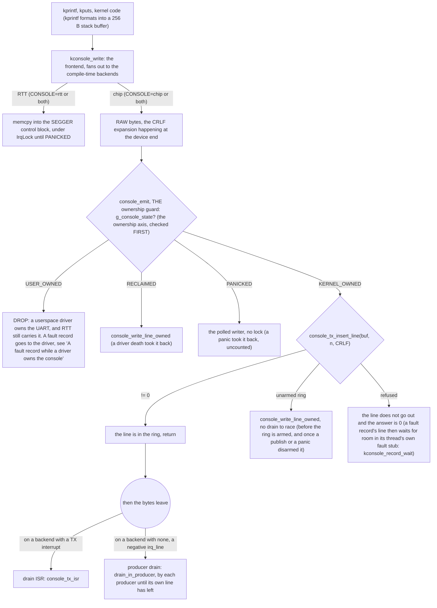

<!-- SPDX-License-Identifier: CECILL-C -->
<!-- Copyright (c) 2026 Philippe Leduc -->
# The kernel console

> Reference (code-synced): how the console works *as built* and the invariants a
> change must not break. The how-&-why narrative belongs in `../book/`; this page is
> the exact contract.

## What it is, and what it is not

The kernel console is a **write-only debug facility**: the banner, `kprintf` /
`kputs`, panic and fault reports, and, until a console is published, userspace's output
(`stdout: kernel`, and the raw `kos_kconsole_write` syscall).
It is the standard microkernel *exception* -- a minimal, kernel-owned output path
that must work during bring-up, in a fault, and before any driver exists. It is
**not** a general device driver: the eventual userspace UART/console driver is a
separate thing that will take the peripheral as a capability (see
[architecture.md](architecture.md), "Object model, capabilities & IPC" ->
"Console device handover"). Keep that
distinction -- much of the design below exists to protect the *debug* console's
"always works, even while dying" guarantee.

**The console is the kernel's until a userspace service holds it.** From the publish on, user
output goes to that service alone, and the kernel console refuses a user write with
`-KOS_EBUSY`, in every state that follows: the hand-off, the driver's ownership, the reclaim
after its death and a panic. The kernel takes the device back for itself only: its panic, its
fault records and its own lines. No user output falls back to the kernel console.

## The user's console contract

A task writes its standard output through capability 0 with `kickos::stdout_write`
(`<kickos/sys/emit.h>`), which `write(1)`, `printf` and `kos_print` all use. The contract is the
same whatever serves it:

- **A blocking write blocks** until every byte is taken, as a pipe's writer does, and ends early
  only at its own kill or slay, or at a refusal: `EFAULT` for a buffer the kernel cannot read,
  `ECANCELED` for a writer cancelled while it waited, `ECONNREFUSED` for a console whose service
  is gone for good, nobody left able to restart it, `EBUSY` for a standard output of the kernel console once a console is published, and
  `EPIPE` or `EINVAL` where the route behind capability 0 refused the message.
- **A non-blocking write never waits.** With `O_NONBLOCK` set ("Non-blocking stdout") a write that
  would wait returns the bytes that went, or -1 with `errno` `EAGAIN`.
- **The atomic unit is one chunk.** A write of at most `KICKOS_KCONSOLE_CHUNK` bytes
  (`<kickos/diag.h>`) reaches the wire whole beside every other writer's; a longer one may meet
  another writer's bytes at a chunk boundary.
- **A writer killed in a write leaves nothing held**, and the next writer goes on.

## The pipeline



Source: `kernel/init/console.cc` (frontend + routing + panic), `kernel/init/console_tx.cc`
(the ring + drain + arming), `lib/include/kickos/console_tx.h` (the seam), and the
per-chip backends under `arch/*/chip/*`.

## The frontend: `kconsole_write`

`kconsole_write` fans out to every **compile-time-enabled** backend (`KICKOS_CONSOLE`
= `chip` | `rtt` | `both`, lowered to `KICKOS_CONSOLE_CHIP` / `_RTT` by CMake):

- **RTT** (`lib/rtt.cc`, channel 0) is a `memcpy` into a RAM control block that a
  debug probe drains; it is written under a short `IrqLock` because the same ring
  is touched from thread/ISR/fault contexts. It is arch-neutral (nothing Cortex-M
  in it). Channel 1 of the same block carries binary telemetry -- see
  [telemetry.md](telemetry.md).
- **chip** is the UART path. On MCU builds `'\n'` is expanded to `'\r\n'` here
  (`KICKOS_CONSOLE_CRLF`, off on the sim so the TAP stream stays raw); each
  resulting chunk goes through `console_emit`.

RTT and the UART are **separate transports** and can both be enabled -- RTT is not
a UART tee. Note that RTT needs a debug probe attached, so it is a
dev/bring-up transport, never the sole panic path in the field (see "The contract").

## The routing guard: `console_emit`

A user write is admitted in `KERNEL_OWNED` alone. In every other state it is refused
`-KOS_EBUSY` under the same masked read that counts a writer, before it reaches the device or
RTT, so a publish racing it hands the device over with no user byte behind it. That holds after a
panic too, on a board that never published: the panic takes the console for the kernel's lines
alone.

`console_emit` is the **single choke point** that decides where output goes. It first
consults the **ownership axis** `g_console_state` (who owns the UART TX register),
because in the middle value the kernel must touch the device on *no* path at all:

```
a user write  ->  REFUSED -KOS_EBUSY in every state but KERNEL_OWNED, under the same read
USER_OWNED    ->  DROP: the kernel touches nothing (RTT still carries the bytes)
RECLAIMED     ->  console_write_line_owned (a driver death reclaimed the UART -> polled only)
PANICKED      ->  the polled writer, without the lock (a panic reclaimed it for good; the
                  writer is not counted, since no publish leaves PANICKED)
KERNEL_OWNED  ->  console_tx_insert_line  (the ring's insert)
```

`arch_in_isr()` is NOT a condition here. It stood for "this context may not wait", which was
true of the burst producer the ring once had and is not a rule about buffering:
`console_tx_insert_line` never waits under its lock.

`g_console_state` starts `KERNEL_OWNED` (every board that never hands over stays here
until a panic); a publish moves it to
`HANDING_OFF` from any state, drains the in-flight chip writers, and only then flips `USER_OWNED`; and a
panic flips it to `PANICKED` **from any prior state, `KERNEL_OWNED` included** -- the axis records a publish, never whether the device is garbled, and a
thread granted the console window can wreck the channel without ever publishing. See
[architecture.md](architecture.md), "Console device handover".

**Every line the ring accepted before a publish goes out before the driver has the UART.** The
move to `HANDING_OFF` gives up the ring under the same `IrqLock`, and giving it up flushes it
(`console_tx_deinit`): its bytes are in the device's transmitter before `USER_OWNED` is stored. A
line the ring refused was never accepted, so it is not among them: a kernel line is lost, and a
user writer waiting for room is woken by the publish and refused.

`HANDING_OFF` exists because the two halves of a publish cannot be one instant. It refuses
NEW chip writers while leaving the UART the kernel's, so a writer already counted in the
in-flight bracket can finish on a device it still owns. Flipping `USER_OWNED` in the same
masked region as the ring teardown instead makes an in-flight chunked writer resume, find
the device no longer the kernel's, and drop the rest of its message with nothing said.

The load-bearing invariant of the whole design is **line atomicity**: a reader parses lines,
so bytes from two producers inside one line destroy it while whole lines in any order stay
legible. `console_tx_insert_line` copies a whole line under one `IrqLock` or refuses it, and a
refused line DOES NOT GO OUT, so nothing writes at the device beside a running drain. A panic
still takes the polled path: the system stops afterwards, so a line left queued is a line nobody
reads.

**Across cores, the speaker is the device owner, not the CPU.** SMP cores in one kernel
insert normal lines into one ring; one drain sends its bytes. Kernels share no UART: an own-image
AMP node's kernel drives the UART its partition gives it, or none ("An AMP node's console").

**Inside one node, a line is one context's until it ends.** Every console written polled keeps
one context's line whole this way, the reclaimed console and an unarmed ring included (clause
2). Another thread's write waits for that line, parked until the writer's call returns or the
line ends, and a task that set O_NONBLOCK is answered `-KOS_EAGAIN`. A kernel line that finds the
line taken, an interrupt's included, is dropped, as a line the ring refuses is. A holder slain
mid-line gives the line up at its exit. A panic writes regardless.

The ring is therefore MULTI-producer, and the exclusion is the lock rather than a structural
claim about callers. What the ring buys over the locked writer is the SHAPE of the masked
window: a copy instead of a transmission. That is why the ring's size is derived from the line
bound (below) and never set. No path writes a line at the device under that lock while the ring
is armed.

## An AMP node's console

In an own-image AMP partition no kernel owns a UART by default. The integrator gives each node's
kernel one in `CONFIG_KICKOS_AMP_CONSOLES`, one entry per node in node order, `/dev/uartN` or
`none`, and `genconfig.py` refuses a UART named for two nodes. A node's kernel output, its banner,
fault records and panic included, goes to its own UART, or nowhere when its entry is `none`
(`KICKOS_CONSOLE_CHIP` and `KICKOS_CONSOLE_RTT` are then 0 in that image, so no path of its
kernel touches a UART, and no node's kernel touches another node's UART, its bring-up included).

A node's tasks write their own UART, or another node's console as an ordinary cross-node service:

- The owner node's composition runs the stock relay, the program `amprelay`
  (`system/service/amprelay/`), serving a port the partition names for that node. It receives each
  message and writes it in one write on its own standard output. A call, a console request such as
  `kos_console_flush`'s drain, it makes again as a call on that standard output and answers with what
  that answered, empty where it was refused; it ends with status 1 once its port refuses a receive.
- The writing node's composition names that port as its standard output, `stdout: /amp/N`; the
  host tool refuses a port this node serves or no other node does, and a node's standard output
  that reaches no console: `stdout: kernel` on a node whose entry is `none`, or a chain of relays
  that loops or ends there. The kernel seats every thread's capability 0 on the far endpoint at
  boot (`cap_stdout_far_seat`), touching no console state, and refuses a spawn whose child it
  cannot seat there.
- A write is then far sends of up to `KOS_EP_MSG_MAX` bytes each, and a far
  send is a rendezvous: each returns only once the relay has received it, after waiting for a slot
  of its port's lane of the call ring toward the owner where that lane is full
  (`ipc-call-reply.md`), so nothing is lost and a writer's `write` returning means the relay holds
  its bytes. A cross-node rendezvous cannot complete without waiting, so a non-blocking writer is
  always answered `EAGAIN`. A send the peer's ring refuses ends the write with `EPIPE`, a ring that
  moved back under it, or `EINVAL`.
- The relay runs at the priority its composition gives it. A relay that never runs, starved or
  stopped, leaves its blocking writers waiting, as a pipe nobody reads does.
- An unbuffered standard output writes byte by byte, and each byte is then a cross-node
  rendezvous through the relay. newlib-nano's stdout is unbuffered on a node with no heap for its
  stream buffer. This is the integration's choice, not a kernel or libc matter: the common shape
  gives each node a UART of its own, and otherwise the writing node's composition declares a heap
  or its application buffers its own output (`setvbuf`).

The in-tree partitions show both shapes: `qemu-arm64-amp2` gives each node a PL011, and
`qemu-arm64-amp3`, `pizero2350-amp2` and `esp32c6-wroom-amp2` give node 1 none, its tasks writing
through node 0's relay on port 6.

## The buffered path (multi-producer ring)

The ring decouples a write from the UART bit rate. The polled alternative busy-waits
on the TX-ready flag -- telemetry measured that as the single largest on-CPU cost
(~879 us per burst at the K64F FEI clock). The buffered producer instead copies and
returns; the bytes leave later, in an interrupt.

- **Producer** (`console_tx_insert_line`, any context): under `IrqLock`, count the bytes the
  line needs once `\n` is expanded, refuse if they do not fit, else copy the line into
  `[head, ...)` expanding as it goes, publish the new `head` and enable the TX-empty IRQ
  ("prime the pump"). Returns immediately -- the caller's cost is a copy, not the
  transmission.
- **Consumer** (`console_tx_isr`, ISR context, bound to the chip's TX line via
  `irq_attach`): push ring bytes while a HW TX slot is free; when the ring drains
  to empty, disable its own TX IRQ. A chip whose console has no TX interrupt reports
  `irq_line < 0` and is drained instead by `drain_in_producer`, in the producer's own
  context, by every producer until its own line has left. Each byte is taken and pushed
  under the lock into a slot found free there, so producers drain one ring in order and none
  holds a byte across a preemption; only the wait for a slot runs with the lock open.

**Why the lock is brief, and why it is correct.** The drain ISR runs at
`PRIO_DEVICE` (0x30). `IrqLock` raises `BASEPRI` to 0x20, which masks everything
numerically >= 0x20 -- including the TX ISR (`arch/arm/armv7m/regs.h`). So the
producer's "publish head + enable IRQ" is atomic with respect to the ISR's "drain
to empty + disable IRQ": either the ISR's empty-check happened before the publish
(then the producer's enable re-arms it) or after (then the ISR sees the new bytes
and keeps draining). **No lost wakeup.** For an insert the lock is held
for the copy plus a pointer store and one bit -- microseconds bounded by the ring
size, not the ~22 ms a 256-byte transmission used to hold. The copy is inside the
lock, not outside it: that also serialises concurrent *thread* producers, which the
single-producer argument alone would not cover: the ring takes a line from any
context, so its producers are many and only the lock orders them.

**Overflow policy: DROP, not stall and not a fallback write.** A line the ring cannot
take does not go out, and `console_tx_insert_line` answers zero so the caller knows.
The reason is that the alternative is unavailable rather than merely slower: the drain
is already a writer at the device, so a producer writing the refused line there itself
puts a SECOND writer on the wire and the two interleave mid-line. No locking discipline
around the fallback fixes that, because the interleaving is between the fallback and a
drain that is not holding the lock. A kernel line is lost to it; a user writer and a fault
record's line wait for room instead, as below.

**A fault record's line waits for room, bounded.** A thread-fault record (`kprintf_record`) on the
kernel's own console is refused by a full ring like any line, and nothing of it, or of the lines
queued ahead of it, is written at the device by the refusal. The dying thread waits instead, in
its own fault stub, with interrupts open and no lock held (`kconsole_record_wait`): on a backend
with no TX interrupt it drains the ring itself until the line fits, and on one whose TX interrupt
drains it, it sleeps on the console until that drain has freed the line's room. It then offers the
line again (`kprintf_record`), which RTT, where the build has it, carried on the first offer
only. Each line's wait is bounded: once 50 ms pass with no byte leaving the ring, the channel is
wedged and the line is dropped, so a dead UART costs a dying thread one stall window per line and
never keeps its task alive. The line is also dropped where waiting would wait on the dying
thread's own task or a thread of that task holding the console's registers, and where the thread
is cancelled while it waits.

**This is a trade against "always works, even while dying".** A record line no longer forces its
way past a full ring, so it can now be lost where it used to reach the wire: behind a wedged
channel, under a cancel, or behind its own task. The dying thread's task also lives on while it
waits, at most one stall window per line on a wedged channel. In exchange no task's output can
make the kernel mask interrupts for the wire time of a record line, which it used to for up to
twice a record line's length at the console's baud. Panic output keeps its guarantee:
`kpanic_enter` still masks, flushes the ring in order and writes polled.


The kernel console is a DEBUG facility, so a line lost to pressure is lost and nothing counts it.
The USER path is different: `kos_kconsole_write` splits a write into chunks, waits where the
console cannot take a chunk yet (below), and STOPS at the first byte the console refused and
returns how much landed, in the shape of `write(2)`, or `-KOS_EBUSY` once a console is published.
Carrying on past a refusal would put a hole in the middle of a line whose tail arrived, which is
worse than losing the line.

**The one copy of the userspace policy is `stdout_write` (`<kickos/sys/emit.h>`)**: the TAP harness,
`kos_print` and libc's `_write` all write through it, so `kos_print` blocks where `write(1)` would
and, for a task that set O_NONBLOCK, stops where it would wait. `stdout_write` sends on capability
0, and a receiver taking fewer bytes than a chunk, none included, is offered the rest again there:
the rendezvous consumed the receive, so the next send parks until the driver receives again and
the retry never spins. An empty capability 0 (`-KOS_EBADF`) is a standard output of the kernel
console, which takes the line until a console is published and refuses it `-KOS_EBUSY` from then
on. Capability 0 is the kernel's seat: no holder may close or narrow it (`-KOS_EPERM`), and it
names the published endpoint, a dead one included, until the next publish moves it, in every
console state. `kconsole_write_all`, the entry for a writer that starts at the kernel console,
sends to `stdout_write` what the kernel console refused with `-KOS_EBUSY`.

**A refusal ends the write, as `write(2)` ends.** Any other answer of the send, and any refusal of
the kernel console, stops `stdout_write` where it stands: it reports the bytes that went and that
error, and the bytes after them are not counted taken. No refusal falls back to another route.
That covers a console whose service is gone for good (`-KOS_ECONNREFUSED`: its driver's task
ended and nobody can restart it), a buffer the kernel refuses (`-KOS_EFAULT`), a
writer cancelled while it waited (`-KOS_ECANCELED`), a published console refusing a standard output
of the kernel console (`-KOS_EBUSY`), and a far send the peer's ring refused (`-KOS_EPIPE`,
`-KOS_EINVAL`). libc's `_write` returns the count where any byte went, else -1 with `errno` from
the kernel's error (`ECONNREFUSED`, `EBUSY`, `EFAULT`, `ECANCELED`, `EPIPE`, `EINVAL`, `EAGAIN` for a
would-wait). `kos_print` returns nothing and does what the one writer does.

**newlib keeps the error.** A refused write sets the stream's error flag, and newlib's `printf`
family answers `EOF` while it is set, until the app calls `clearerr(stdout)`; `puts` and `fputs`
do not read it. The bytes of the refused write are gone. Once a restarted console serves
capability 0 again, a later `printf` still reaches it on a line-buffered stdout and on nano's
unbuffered one, but on the full profile's unbuffered stdout it writes nothing until
`clearerr(stdout)`.

**A full ring makes the user writer wait in the kernel, as a pipe's writer waits.** On a backend
with no TX interrupt the writer drains the ring itself, synchronously, sending the queued bytes
ahead of its line until the line fits and never more than the line needs, then its own line: a
writer above the one that queued those bytes does not wait for it to run. On a backend whose TX
interrupt drains the ring the writer sleeps on the console until that drain has freed the room its
line needs (`console_room_wait`, `console_tx_room_freed`), a publish waking it too, which then
refuses it. A TX channel that never drains blocks the writer as a pipe nobody reads does. No bound
gives a line up, and output is not lost. The only way out of the wait is the writer's own kill or
slay, or a publish; a task that set O_NONBLOCK is answered at once instead. A writer whose own
task holds the console's registers is not made to wait for a drain that task can stop: its line
is lost to the kernel console at once. The raw `kos_kconsole_write` is the same kernel write, and
the one call that drops, where its own task holds the console's registers: it answers how much it
took. `<kickos/sys.h>` poisons it,
and `<kickos/sys/abi.h>` its syscall number, in every app TU, so a call whose drop, answer or wait
is the measurement states which at the call, `KICKOS_KCONSOLE_MEASURED(DROP, buf, len)` or
`ANSWER` or `WAIT`, and `user/apps/CMakeLists.txt` refuses a raw spelling in an arm no build
compiles.

**A thread of the task that serves the console has no capability 0.** A send there would wait on
the very receiver that is sending, so neither the spawn nor a publish seats one in it, and a
publish empties the one a member already holds (`cap_console_serve`). Its `kos_print`, `printf`,
`std::terminate` and exception reports take the kernel console, which refuses the line at once
(`-KOS_EBUSY`), RTT included. A driver that needs a line on the wire writes it through its own
device path.

### Non-blocking stdout

A client sets stdout or stderr non-blocking with `fcntl(fd, F_SETFL, O_NONBLOCK)`, and `F_GETFL`
reads the flag back (`user/src/newlib_fcntl.cc`). Blocking is the default. Fds 0 to 2 share one
description, the console, and its O_NONBLOCK is ONE flag per task, shared by all the task's
threads as a process's threads share an open file description, and no other task's: libc keeps
it in one word of the task's image (`kickos::stdout_nonblock`, `<kickos/sys/emit.h>`), so `fcntl`
is no syscall and the kernel keeps no flag. A thread spawned naming no task and no memory of its
own joins its spawner's task, so threads never placed in tasks share their spawner's flag.
`kickos::stdout_write` reads the flag and asks the kernel not to wait:

- Its send on the published console takes `KOS_POLL` in place of `KOS_NEVER`, so a
  console whose task lives with no receiver taking a message now is answered `-KOS_EAGAIN` at
  once, which ends the write; the kernel console is not asked.
  A call, `kos_console_flush`'s included, and a send on any other endpoint are not touched.
- Its kernel console write passes `KOS_KCONSOLE_NOWAIT`, and one that would wait or have to try
  again is answered `-KOS_EAGAIN`: a full ring, another thread's line on the same node. Any other
  flag is refused `-KOS_EINVAL`.
- It stops at that answer and reports it with the bytes that went, so a write
  that would block writes nothing and returns -1 with `errno` `EAGAIN`, and the task carries on.
  A partial accept returns the short count: a receiver taking part of a message, or a kernel
  console taking part of a write.
- A local console never answers `EPIPE`. A console whose service is gone for good answers
  `ECONNREFUSED`, blocking or not; one the init can still restart answers a non-blocking writer
  `EAGAIN` until a restarted driver receives.

RTT drops on a full ring for its own reason: its host may be detached, so a blocking
writer would hang forever. A channel that never frees a slot makes the producer drain
reset the ring, which is the one case bytes already queued are lost, and it is the case
where the wire is already dead.

Ring sizing is DERIVED, never set. The knob is the line bound `KICKOS_DIAG_LINE_MAX` (default
256 B, lowered per board where RAM is short), and `kickos/console_tx.h` computes the ring as
`2 * (KICKOS_DIAG_LINE_MAX - 1) + 1` rounded up to a power of two. The kernel owns the storage
(`kickos_console_tx_storage`), which a chip's backend names. What `kernel/init/console_tx.cc`
still asserts is the one relation no derivation covers: the FAULT reporter's separate buffer
(`KDIAG_FAULT_LINE_MAX`) may not exceed the ordinary bound, or the ring would refuse every
such line and the record would never reach the wire.

## The synchronous path and the panic-safe seam

`arch_console_write_sync` is the bounded polled writer -- the one that is safe with
the scheduler and IRQs down. It has no fallback, so the link fails on a chip without one:

- Every chip **defines its own** bounded polled writer (the fleet wraps its TX-ready poll
  in a spin-then-drop guard, so a wedged UART drops bytes instead of hanging the panic
  path, and answers false once it stalled); the sim defines a bounded `write(1, ...)` to
  host stdout.

**Panic and fault.** `kpanic_enter` masks, then under one `IrqLock` takes the panic claim and
reclaims the device (the first claimant only, and not after a driver death's reclaim), flushes
the ring in order (`console_tx_flush_sync`, the TX IRQ disabled first so the ISR cannot race the
drain), disarms it, and stores `PANICKED` last, which routes every later line to the polled
writer without the lock. Until that store another core's line waits on the lock. A writer on
another core that read `KERNEL_OWNED` before the panic and inserts after the flush finds the ring
disarmed, so its line goes out polled and whole, between the panic's lines and never inside one.
`kickos_isr_fault` funnels through `kpanic_enter` first too.

## Per-chip backend

A chip with a buffered console supplies a 4-function struct, naming the kernel's ring storage,
plus one hook:

```c
struct console_tx_backend { slot_free; push; irq_enable; irq_disable; storage; };
console_tx_backend const* arch_console_tx_backend(int* irq_line);
```

`console_buffer_init` (called from `kmain` after `irq_init`) asks the chip for its
backend; if present it binds `console_tx_isr` to `irq_line`, unmasks the line
(priority lands in the `IrqLock`-maskable band), and arms the ring. The generic
ring never names a register; the chip supplies only these pokes. Every chip supplies one
(`grep -rn "arch_console_tx_backend(int" arch/`); three illustrative ones:

- **K64F (Kinetis UART0)** -- `slot_free` = `S1.TDRE`, `push` = `D`, the IRQ gate =
  `C2.TIE`, line = **IRQ 31** (UART0 RX/TX combined). `arch/arm/chip/mk64f/chip_mk64f.cc`.
- **XMC4800 (USIC0 CH0, ASC)** -- `slot_free` = `TCSR.TDV` clear, `push` = `TBUF0`,
  the IRQ gate = `CCR.TBIEN` routed by `INPR.TBINP` to service-request output SR0,
  line = **NVIC 84**. The gate lives in the shared USIC layer
  (`usic.cc`: `tx_irq_route`/`enable`/`disable`); the backend is in `usic_uart.cc`.
- **sim (fictional TX peripheral)** -- `slot_free`/`push`/`irq_enable`/`irq_disable`
  over a host-emulated TX-empty line delivered by `SIGUSR1` (a shared vector with
  the IRQ-inject signal); `push` writes one byte to host stdout, `irq_enable`
  `raise()`s the line, and the drain ISR (`console_tx_service` -> `kickos_isr_irq`)
  runs the real `console_tx_isr`. A **synthetic per-delivery slot budget** forces
  the ring to drain over several deliveries so it genuinely fills, primes, wraps,
  and empties -- host stdout never blocks, so without it the ring would drain in one
  shot. `arch/sim/sim.cc`.

A chip's TX IRQ-line number is a HW-confirm item (a wrong line never drains -- the ring
fills, every line after it is refused, and the console goes dark a few lines into the
boot, with no diagnostic naming the line). The buffered drain is **silicon-validated** on
the XMC4800, ESP32-C6, and K64F (a full selftest streamed in-order over the armed ring).
The **sim's backend** additionally exercises the full ring -- producer, publish+prime,
async drain ISR, wrap, and overflow -- in-tree under `ctest`, which is what a
sync-path-only run cannot cover.

## Boot ordering

The banner prints from `kmain` **before** `irq_init` -- the ring is not armed yet,
so it goes out on the sync path. `console_buffer_init` arms the ring immediately
after `irq_init`; steady-state logging from then on is buffered. So the ring speeds
ongoing logging, not the one-time banner. (If banner cost ever matters, bring-up
would have to be reordered so the console arms earlier.)

## The sim

The sim supplies a **fictional TX peripheral** (see Per-chip backend above), so it
arms the buffered path like a real chip: after `console_buffer_init`, steady-state
writes go through `console_tx_insert_line` into the ring and drain asynchronously in
a `SIGUSR1`-delivered TX-empty ISR. This is deliberate -- the MCU backends never run
in-tree, so the sim is the **only** in-tree exerciser of the ring/drain/wrap/overflow
paths; the selftest and stress runs push enough output to fill and wrap the ring
repeatedly under `ctest`.

Details specific to the sim:

- **Output is still raw** -- CRLF expansion stays off (`KICKOS_CONSOLE_CRLF`), so the
  TAP stream is byte-clean for the test harness.
- **The emulated TX line shares `SIGUSR1`** with the IRQ-inject path (a shared
  interrupt vector): `on_sigusr1` consumes the assertion, runs the drain, and
  re-asserts if the synthetic slot budget left bytes queued.
- **The fault handler enters ISR context** (`isr_frame_enter` before `kickos_isr_fault`),
  which no longer changes the transport: the insert never waits, so a fault report is
  queued like any other line and `arch_shutdown`'s flush carries it.
- **`arch_shutdown` flushes synchronously** (`console_tx_flush_sync`) before
  `_exit`, because IRQs/signals are masked there and the `SIGUSR1` drain can no
  longer run -- otherwise the final `[ktrace] counters` line would be stranded in
  the ring.

## The contract

The console's contract is stated here once; `invariants.md` points at these clauses. Each clause
names the section above or below that carries its mechanism.

1. **One gate for kernel lines.** Every chip line kernel code prints passes `console_emit`. It
   first reads `PANICKED` unlocked, and a line that finds it is written polled and uncounted;
   otherwise one masked step reads the state and, in `KERNEL_OWNED` and `RECLAIMED` only, counts
   the writer in `g_chip_writers`, so a publish drains every writer it let through. The writer
   then acts on that read and never reads the state again. The other device writes are the
   kernel's own and do not pass the gate: the ring flush of `kpanic_enter` and of
   `kickos_terminate`, the held records the reclaim writes (`console_flush_then_reclaim`,
   `console_held_write_sync`) and its own line on the driver's death, the line of a refusal under the kernel lock (clause 8), and on q35
   the boot refusals and exit line `chip_q35.cc` writes with `com1_puts` ("The routing guard").
2. **One line is one indivisible insert.** `console_tx_insert_line` copies a whole line under one
   `IrqLock` or refuses it, and a refused line does not go out: the drain is already a writer at
   the device, and a second writer beside it interleaves mid-line. The unarmed ring, before
   `console_tx_init` and after a publish or a panic disarmed it, and a reclaimed console write
   the line polled with `console_write_line_owned`: each wire byte is a masked span of its own,
   and the line is the writing context's until it is written, another thread's write waiting for
   it and a kernel line that finds it taken, an interrupt's included, dropped. A path that splits
   a line across two inserts, or writes a line's bytes outside one `IrqLock` span or that
   ownership, puts one producer's bytes inside another's line ("The buffered path").
3. **The ring drains.** Its consumer is the TX-empty ISR on a backend that has one, and every
   producer until its own line has left on a backend that does not (`irq_line < 0`). The TX ISR
   sits in the `IrqLock`-maskable device band (`PRIO_DEVICE`), so the producer's publish and prime
   are atomic against it, and the TX IRQ is enabled whenever the ring is non-empty: the ISR
   disables it only on drain-to-empty, and the producer always re-enables it after publishing.
   It is stated of ONE ring over one gate bit, and no UART is shared between kernels ("An AMP
   node's console").
4. **A fault record's line waits for room with interrupts open.** Refused by a full ring, it
   writes nothing at the device; its thread drains the ring itself or sleeps until the drain
   frees the room, then offers the line again. One stall window with no byte leaving the ring
   drops the line, and so does a wait that would wait on the thread's own task ("A fault record's
   line waits for room, bounded").
5. **A publish hands over every line the ring accepted.** It refuses new chip writers
   (`HANDING_OFF`), flushes and disarms the ring under one `IrqLock`, drains the writers already
   counted, and stores `USER_OWNED` last ("Capability handover").
6. **While a driver owns the UART the kernel writes nothing at it**, a fault record included:
   kernel lines drop (RTT still carries them), a fault record is held whole and handed to the
   driver between two of its receives, and a user write to the kernel console is refused
   (`-KOS_EBUSY`). A kernel write at the device beside the driver's drain interleaves with it
   byte by byte ("A fault record while a driver owns the console").
7. **The console returns to the kernel, and to the kernel alone, on every path that ends its
   driver.** A driver dies only with its task; the reclaim waits for every thread holding the
   console's window, runs once, writes what the driver never took, then the kernel's own line
   on the death, `kernel: console driver task ended, console reclaimed`. From the publish on, until
   the next publish and after it, a user write to the kernel console is refused `-KOS_EBUSY` at
   once, so no user thread waits on the device's return ("Capability handover", "The publisher's
   obligations").
8. **Panic output depends on neither the buffered path nor a debug probe.** `kpanic_enter` masks,
   reclaims once from any state, flushes the ring in order and writes polled, bounded on a wedged
   channel; RTT needs a probe and the driver may be what crashed. The diag LED is the
   always-present 1-bit last resort ("The synchronous path and the panic-safe seam").
   **A refusal raised inside the kernel lock's acquisition, or while a core holds that lock
   outside an IrqLock, takes no lock** (`kpanic_refuse_unlocked`): it disarms the ring, stores
   `PANICKED`, reclaims the device, writes its own line polled (and to RTT where the image has it)
   and terminates. The ring's unsent tail and the held records may not reach the wire then.
   Whichever failing core claims the panic first reclaims, and no other. Once `PANICKED`, every
   line is written without the lock, polled on the chip and straight into the RTT block, so lines
   of two cores failing together may interleave byte by byte.
9. **A user writer blocks as a pipe's writer does.** It waits for room or drains the ring
   itself, and stops only at its own kill or slay, or at a refusal; a task that set `O_NONBLOCK`
   is answered `-KOS_EAGAIN` instead. Short counts are reported, a refusal ends the write and
   falls back to no other route, a console whose service is gone for good refusing it
   `-KOS_ECONNREFUSED`, and a writer whose own task holds the console's registers is not made to
   wait ("The user's console contract", "The buffered path", "Non-blocking stdout").
10. **No UART is shared between kernels.** An own-image AMP node's kernel writes the UART its
    partition gives it, or nothing, panic included; its tasks reach another node's console only
    as that node's service, through `stdout: /amp/N` and the node's relay ("An AMP node's
    console").
11. **A clock retune touches the console only while the kernel owns it.** `cpu_clock_set` reads
    the state under the same `IrqLock` it retunes under, waits for the transmitter to go idle
    (the ring keeping its bytes), and reprimes the ring's drain after the baud is rewritten
    (`console_tx_reprime`); the whole retune sequence is `clock-retune-coherence-tail` in
    `invariants.md`.

## Capability handover

`console_tx_deinit` (flush -> disable
TX IRQ -> `irq_detach`/NVIC-mask -> disarm the ring, all under one `IrqLock`) relinquishes
the buffered path. A console driver's `kos_task_create`, gated on `AUTH_CONSOLE`, calls it, as
the syscall the console publish call (29) does for an empty task an app fills, takes a kernel ref on
the stdout endpoint, and flips `g_console_state` to `USER_OWNED` last. A
stale in-flight chip writer that raced the flip is drained via the `g_chip_writers` count
before the publish returns, and before the driver's entry thread first runs, so no driver code
touches the device under it: the publisher parks on the console (`console_publish_drain`) and the
last counted writer's leave wakes it, so a writer below its priority runs to that leave. Those
writers never block, so a kill standing against the publisher does not end the wait, and a
writer slain inside the bracket leaves it with its exit (`kconsole_slain`). A publisher slain
in the drain never hands the console over: its exit stores `RECLAIMED`, so the console is the
kernel's, polled, until the next publish, and the records held since the hand-off began are
written then. The panic path
funnels through `kpanic_enter`, which flips the UART to `PANICKED` and polled-prints; a panic
landing during the drain keeps the device, and the publish's last step hands nothing over.

**Who may publish, and what HANDOUT allows.** The caller holds `AUTH_CONSOLE` (`-KOS_EPERM`
otherwise) and names an endpoint through a capability holding HANDOUT: `-KOS_EBADF` for a bad,
stale or non-endpoint capability, `-KOS_EACCES` for one without HANDOUT, a WAIT-only capability
included. A console driver's create names it as the delegated capability at its declaration's
ready position, and the task it creates is the one the console is published for. the console publish call
also names the TASK the driver runs in, whose end is the driver's death:
`KOS_TASK_NONE` for the caller's own, or a task the caller created (`-KOS_EBADF` for a handle naming
nothing, `-KOS_EPERM` for another creator's, `-KOS_EBUSY` for one already ended). `-KOS_EBUSY` also answers a publish while another
is still handing the console over, and any publish after a panic. It also answers a task a thread outside
of which holds the console's registers (below). The publish seats WAIT on that capability when it
does not hold it already, counted in `recv_holders`, and the endpoint receives as a fresh one does
for its creator. Every publish therefore leaves the publisher holding WAIT and HANDOUT, and a WAIT
it drops at the end of the handover. An endpoint's
creator holds all four rights, so a first publish goes through the creator's capability. HANDOUT
is also what lets the init, which keeps a console driver's endpoint narrowed to SIGNAL, TRANSFER
and HANDOUT between its instances, publish it again at every start: a restart repeats the first
handover step for step. `-KOS_EOVERFLOW` answers a reference or receiver count at its ceiling. A
refusal changes nothing: no right seated, no reference taken, the console untouched.
`cap_console_publish_through` in `kernel/syscall/cap.cc` is the rule.

**A DRIVER DEATH is the second route to `RECLAIMED`, and a driver is dead only when its task
dies.** The task the console was published for ending, or its slot going back before it ever ran,
NOTES the death (`task_end`, `cap_console_task_ended`); a kill or a slay of that task ends it at
once, before its members have run to their deaths (`task_stop`), and `console_on_driver_death`
then asks the
DEVICE: it defers while any live thread still holds `arch_console_reclaim_window()`. The task's end
slays every member, so a holder of that task is gone in finite time: the note stays SET across a
refusal and every `exit_current` re-runs the check, so the LAST holder's own exit reclaims. A
death noted while a publish is still handing the device over is acted on when the hand-off
completes (`console_owner_set_user`), so no path erases it; only the next publish retires it.
The reclaim writes, polled, the records held for the driver and then the kernel's own line on the
death, `kernel: console driver task ended, console reclaimed`, a kernel message no user writer
is involved in. A panic's reclaim writes no such line.

**The console's registers stay inside the task the console is published for.** A publish is
refused `-KOS_EBUSY` while a thread outside the task it names holds a device window over
`arch_console_reclaim_window()`, and from the publish to the reclaim a spawn giving such a window
to a thread of any other task is refused `-KOS_EBUSY`; a window is taken only at a spawn, so no
other path moves one. Every holder the reclaim waits for is therefore a member of the task whose
end it follows, which that end slays, so the reclaim always comes.

**A publish onto another endpoint moves stdout with it, and the writers parked on the old one
(ruled 2026-11-25).** Every thread's capability 0 naming the console it replaces, a dead one
included, is seated on the new endpoint, and every sender parked on the replaced one moves, in its
order, to the new one's queue and keeps waiting there under its own deadline, its donation
following it to the new server (`senders_move`, `kernel/syscall/cap.cc`). The serve that names
the console's task hands the work waiting on it, held kernel records first, then writers in their
order, to a driver already parked receiving there, through the take a receive runs
(`endpoint_pair_waiting`), under the same lock: each time to the highest-priority receiver that may
take, a dying one passed over, and only where the map loaded admits every store into it, both
sides staying parked otherwise. A restart publishing the same endpoint again leaves every seat as it is, and the
endpoint takes sends again once its task is named. **The first publish seats every live thread's
empty capability 0** on the console the same way, one admission per task, a task its budget
refuses keeping its empty seats; the console's own task is emptied again as it is named
(`cap_console_serve`). So a thread spawned before the first publish writes to the service after
it, and the kernel console refuses only a thread no seat could reach.

**From the task's end on, the console endpoint hands a line to no receiver** (`EP_CONSOLE_ENDED`,
`endpoint_takes_to` in `kernel/syscall/syscall_internal.h`), though a receiver of it may still
wait: its receivers are that task's members, slain but not yet gone, and a line handed to one dies
with it. A held fault record is handed to no receiver either. The endpoint is then answered as any
endpoint is: a sender waits while a holder of WAIT or HANDOUT remains, the init that can restart
the driver among them, and is taken by the restarted instance; once neither remains the endpoint is
dead for good, and every sender parked there is refused `-KOS_ECONNREFUSED`, and a new one at once,
which ends its write. The next publish lifts the end.

**The published endpoint losing its last receiver is no death.** A driver whose service thread exits
while its task lives is a live endpoint with no receiver: a send parks there, receiver or not, as a
write to a pipe does, and a receiver coming back takes it.

**The reclaim runs once.** A driver-death reclaim stores `RECLAIMED` before its body, and nothing
after it reprograms the device again: a fault record still open across it is written by it, never
by the record's own end. **The panic reclaim is unconditional-once, not handover-conditional.**
`kpanic_enter` reclaims from any state but `RECLAIMED` (a driver death's reclaim having run), for
the first panic only, and it takes that claim *before* calling the body. Two properties follow.
It runs exactly once, so a body that truncates the byte in the shift register cannot cut the
banner it just printed; and a synchronous fault *inside* the body re-enters `kpanic_enter` and
stops rather than recursing. The safety of reclaiming a device no driver ever touched rests
entirely on every chip body being **idempotent absolute stores**, which `arch.h` requires, the
no-op fallback in `arch/seam_defaults.cmake` included.
`esp32c6` is the one body that is not pure straight-line: its `_SYNC` stores land only on
the closing `REG_UPDATE` write, so it first waits out the previous synchronisation. That
wait is bounded and read-only, so re-entry from a nested fault still repeats harmlessly.

Known artifact (XMC4800 ASC): if the crashed driver cleared `SCTR.PDL`, the TX pin is
held low across the fault, and reclaim's return to idle-high frames exactly one spurious
leading byte (~`0xC0`) before the panic banner. It is a physical UART line-recovery
transient (not lost/garbled output); the banner and fault dump that follow are byte-clean.

**On q35 the kernel writes COM1 under a holder.** `arch_shutdown` prints the exit line there, and
a panic its report, whatever task holds the 16550's ports, and the no-op reclaim below restores
nothing first: a holder that reprogrammed the device garbles both (`boards.md`, the
`qemu-x86_64` caveats).

The chips with a real `arch_console_reclaim` body are what
`grep -rn "^void arch_console_reclaim(void)" arch/` reports, minus the declaration in
`arch/include/kickos/arch/arch.h`. The others keep the no-op fallback, so on their boards the
state flips and the polled route is restored, but the device is whatever the driver left. The
real bodies are silicon-only (no emulated board carries one), and the `xmc4800` one is
witnessed by `conreclaim` (`c5d9b0d`). See
[architecture.md](architecture.md), "Object model, capabilities & IPC" ->
"Console device handover".

## A fault record while a driver owns the console

A thread-fault record (`kickos_thread_fault_exit`, and the selftest trap witness) is the one
kernel print that still reaches the wire while a userspace driver owns the UART, and it reaches
it THROUGH THAT DRIVER: the kernel writes none of it at a device it handed away. Each
`kprintf_record` line the reporter prints goes to the kernel console as before; from `HANDING_OFF`
on, the chip path refuses it and the same masked read holds it in the record of the thread
printing it instead, opening that record on its first such line. `krecord_end` ends the record.

- **Whole.** A record is held in the disarmed ring's storage, idle from the publish on, and a
  reader sees it only once `krecord_end` commits it, at most `KDIAG_FAULT_RECORD_MAX` bytes. A line
  the room left cannot take ends the record there, so it never carries a cut line. Records of
  several threads written at once are each held, keyed by the thread, and read in the order they
  were committed. A record begun while the kernel still owned the console, with a publish landing
  inside it, keeps its tail: the lines before the publish went to the wire, the rest are held. A
  record with no room left at all is not held, and neither is any record on a console with no
  ring, an own-image AMP node or a chip that supplies no buffered backend; such a record reaches
  RTT where the build carries RTT, and otherwise nothing. A thread slain inside its record never
  ends it, and the slay drops it; one faulting again inside its own record adds to it.
- **Between two receives, never inside one send.** `krecord_end` commits the record and hands it
  to a receiver already parked on the published endpoint (`cap_console_deliver`). A driver that
  is not parked, mid-write in its own drain, takes it at its next receive, ahead of every queued
  sender, and a record wider than its buffer arrives over consecutive receives with nothing in
  between. The record therefore lands between two messages of the driver's input, and a line one
  send carries is never split by it. A line a writer splits across sends can be; the banner opens
  with a newline of its own, so a record never shares a line with user bytes.
- **A held line never makes the faulting thread park**, and nothing waits on time.
- **Each line reaches the wire once.** The reclaim flips the state, writes every held record and
  empties the store under the lock the hold takes, so a line printed before it is held and
  written by it, and a line printed after it reaches the device directly: a record the console's
  death lands inside is written in two parts, with other lines possibly between them, and never
  twice. The write moves nothing in the store: the committed records, the first from the line
  after the one its reader was cut in, then each open record's lines, records in the order they
  opened.
- **What still loses it.** A held record a driver never received is lost when the system ends,
  since `kickos_terminate` may not write a device the driver owns, and one the driver received is
  lost with the rest of its ring. A driver death that reclaims the device writes what the driver
  never took, polled (`console_on_driver_death`), and so does a panic (`kpanic_enter`); where the
  driver had taken part of a record, that write starts at the next line of it, so the line the
  driver was cut in is lost. The panic's write takes the lock the store is changed under, so
  another core's change finishes first; a panic raised on the core changing the store, by a fault
  inside the change, writes nothing held. Every walk of the store stops at an entry that does not
  fit below its end, so a torn one is never followed off the ring, and the panic's own output is
  never cut.
- **Bounded by the ring.** Every step on the store runs under the lock, over the ring's storage,
  `KICKOS_CONSOLE_TX_SIZE` bytes, which the board sets through `KICKOS_DIAG_LINE_MAX` and no task
  can grow. A held line walks the open area at most once per open record, plus three; a commit
  makes at most L + 6 passes over it, L the lines of that record; the reclaim's write walks it
  once per open record and then transmits what is held, polled.
- **A driver whose buffer refuses the copy is answered `-KOS_EFAULT`**, and the record is taken
  all the same, or every receive into that buffer would refuse it again.

## The publisher's obligations

A publish hands the device away but cannot police what the publisher does next. Three properties
of the published console are therefore contracts on the PUBLISHER, not things the kernel
enforces. For a packaged console driver the publisher is the init, and its driver path keeps
them (`system/init/compose/driver_path.cc`); `user/apps/common/initdemo` open-codes the same
sequence with the console publish call instead, being the handover demo rather than a driver.

**Publish and driver start are ONE atomic act.** A console driver's create refuses, before it
publishes, everything it can know: the endpoint, the window, the lines. A publish leaves
`g_stdout_target` naming an endpoint with no receiver while the task it was published for lives,
and every task started afterwards then parks on its first `printf` until a receiver comes. The
kernel cannot tell "published" from "published and served", so the publisher starts no
console-dependent task before the wait below ends. A create that fails past the publish ends
the task it made, that end being the console's death.

**The publisher MUST drop its own WAIT right when the handover ends.** Once the driver's task has
ended, a sender is answered only by an endpoint nobody holds WAIT on, `recv_holders` at **0**. The
publish takes a capability holding HANDOUT and leaves it holding WAIT too, so the drop is owed
after every publish. `kos_endpoint_create` sets `recv_holders = 1` for the creator, a publish
through a capability without WAIT seats the same one, and delegating a `CAP_WAIT` copy to the
driver at its create bumps it to **2**. If the publisher keeps its WAIT, the endpoint still receives
after the driver's task ends: no answer is delivered, parked senders are never woken, and every
client hangs for the life of the system. That is strictly WORSE than a dark console, which is why
the drop is a hard rule and not a tidiness convention.
The init narrows it to SIGNAL, TRANSFER and HANDOUT (`KOS_DRV_HANDOVER_KEPT`), the rights
the init's walk (`system/init/compose/walk.cc`) keeps of every endpoint it creates for a server.
Its task's end then gives the kernel its console back, and a send waits for the restarted driver
while the init's HANDOUT remains (`endpoint_servable` in `kernel/include/kickos/endpoint.h`). The
endpoint outlives the instances
of its driver: a restart's create publishes the SAME endpoint again through that HANDOUT, which
seats the init's WAIT and hands the console over and the new driver on it, and the init narrows,
as the first start did. The init drops the endpoint once its driver is out of restarts, which
leaves it dead for good and refuses every sender parked there; the seats still name it, so the
next publish moves them. Neither drop tears
the endpoint down, because the kernel holds its own
`g_stdout_target` reference.

**The handover ends only once the driver is proven to receive.** After the drop, the init waits on
the driver task's watch until the task reads `KOS_TASK_READY`, a member having waited on the
endpoint, or `KOS_TASK_DEAD`, and no client runs before the wait ends. The wait has no deadline
(maintainer ruling 2026-11-25, dedicated audit C2): a slow bring-up is never cut short, and a
driver that neither serves nor ends holds every later start. The only bound on a bring-up is the
driver's own: a thread past its readiness barrier traps once the latch's budget
(`KOS_DRV_READY_WAIT`) runs out, which ends the task. A task that ends before it is ready, whose end
gives the kernel its console back, is waited to its death, then counted a failed start and
reported, a user line the console no longer carries.

**Two windows are dark on the wire.** The first runs from the publish flip to the driver
serving capability 0: `console_emit`'s chip path already drops (RTT
still carries it) while no receiver exists yet, and a client `send` parks on `send_waiters`
(bounded when timed), the console being live, so the rendezvous absorbs the gap and there is no
"handover in progress" state to size. A restart's window is the same.

The second runs from the driver's task ending to the reclaim, which waits for the thread still
holding the device, or to a restart's publish. The kernel may not touch the device in it either.
A send there waits for the restarted driver where the init can still restart it, and is refused
`-KOS_ECONNREFUSED` where it cannot; a user write to the kernel console is refused `-KOS_EBUSY` at
once: no user line waits for the device. The kernel's own lines are what reach the wire once the
reclaim lands: the fault records held for the dead driver, the kernel's line on the death, then
every kernel line after them.

## The two protocols a published console endpoint carries

A published console endpoint carries **two** protocols on one capability, told apart by
whether the message arrived with a reply capability:

- a **plain send** is raw console bytes (this is the route a publish puts libc stdout on), and
- a **`kos_call`** is a `struct kos_uart_req` frame from `<kickos/sys/uart.h>`.

A driver must therefore receive with `kos_reply_recv` asking for a `struct kos_recv_info`,
and branch on `info.reply_cap`. **A driver that drains the endpoint without separating them
writes the request frame to the wire as though it were text AND never replies, so the caller
parks forever on a reply that cannot come.** An unimplemented op is refused, never ignored:
refusing costs the caller an error, ignoring costs it the system.

**Every op needs a right of the caller's badge** (`<kickos/sys/rights.h>`), checked before the
driver acts on the op, and a missing one is refused `-KOS_EACCES`: `KOS_UART_READ` needs `read`,
`KOS_UART_SET_MODE` and `KOS_UART_CONFIGURE` need `control`, and `KOS_UART_WRITE`, `KOS_UART_STATS`
and `KOS_UART_DRAIN` need `write`, as does a plain send, which a driver drops without it and counts
nowhere a writer reads. `KOS_UART_STATS` answers every receive and IRQ counter as 0 to a caller
without `read`, their timing being the console's input. Every task's stdout seat carries `write`
alone: the kernel seats it with
`KOS_RIGHT_WRITE` and delivers its own held records under that badge. A task that reads the
console or sets its mode holds a use of the console's path, `uses: [{ path: /svc/console, rights:
[read] }]`, whose badge the init mints; a use of the console names the rights it holds, of those
the driver declares (`kickos_add_driver(... RIGHTS write read control)`), and admission refuses one
naming none.

| op | answer |
| --- | --- |
| `KOS_UART_WRITE` | queues bytes; `rsp.len` is the count ACCEPTED, which may be short, and the client retries the remainder |
| `KOS_UART_READ` | up to `req.len` bytes; `KOS_UART_F_BLOCK` is refused `-KOS_ENOSYS` rather than answered with 0 |
| `KOS_UART_STATS` | the driver's `struct kos_uart_stats` counters |
| `KOS_UART_SET_MODE` | the write policy below |
| `KOS_UART_CONFIGURE` | refused `-KOS_ENOSYS` where the device belongs to another thread |
| `KOS_UART_DRAIN` | `status` 0 once the TX ring and the device's transmit path have drained, `-KOS_EBUSY` where the driver's bound expired first |

**`KOS_UART_DRAIN` answers the drain's real result.** The driver replies only once its TX ring
and the device's transmit path have drained or its bound has expired, and the reply's `status`
says which. Every byte a sender's earlier sends delivered was taken before the request, so a
status of 0 covers them. `kos_console_flush(until)` (`<kickos/sys.h>`) is that call on a
thread's stdout, the whole call bounded by the deadline `until`, and answers the status, so a drain that
failed or timed out is reported as a failure. The init ends the system after exactly that
([design-m10-target.md](../design-m10-target.md), section 1.5). A zero-length plain send carries
nothing: it is the readiness probe, and the driver takes it and receives again.
Bytes stdio still buffers were never sent, so an app flushing its output calls
`fflush(stdout)` first. Drained is as
strong as the device allows: the last stop bit on every UART, and the host's acknowledgement of
the last bulk IN packet on USB CDC, where a transfer ending on a full packet is closed by a
zero-length one. The wait is bounded inside the driver, so a device that never drains costs that bound and
never the endpoint. In a two-thread driver only the IRQ thread may touch the device, so the
service thread drains the ring, then asks the IRQ thread for the device's half through the shared
block and waits for its answer under the same bound.

### `KOS_UART_SET_MODE` and the write policy

`req.flags` carries `kos_uart_flags`. `KOS_UART_F_NONBLOCK` is `O_NONBLOCK` **for the
unframed console arm only**: clear, a write waits for ring room and does not give up; set, it
takes what fits and returns. An unknown bit is refused `-KOS_EINVAL` whole rather than masked,
so a flag this build does not know cannot read back as accepted, and nothing is stored on a
refusal.

One refusal is contract rather than omission:

- **A transport whose ring may have no consumer at all REQUIRES the flag and refuses
  `-KOS_ENOTSUP` on a request to clear it.** A blocking write there is unbounded: the USB CDC
  console issues no IN token until a host both enumerates the device and opens the tty, so a
  paced write would hang an un-cabled board at the first `printf` that fills the ring. A
  caller asking for back-pressure it cannot have is told so instead of being given a hang.

**The USB CDC console's output flows once a host configures the device**
(`user/include/kickos/sys/usb_cdc_service.h`; maintainer ruling 2026-11-25, dedicated audit C3).
It waits for no DTR rise and no line coding: bytes that reach the host before its opener sets
the terminal are read in the terminal's default mode, and an integrator who wants a host ready
first delays its own output. Each configuration opens the stream with the banner's identity rows,
ahead of what the ring holds. Until a host reads, a write takes what the ring has room for and
drops the rest. A TAP image waits up to 10 s after its plan line for its console to
drain (`tests/tap/tap.cc`), and then runs its arms whether or not a host read it.

**Where the lost count is reported, and why it is not a return value.** The unframed arm is a
plain send, and a plain send is released the moment the receiver takes the message, in the
sender's own context; the ring accept happens afterwards in the driver's, so the accepted
count does not yet exist when the sender resumes. Loss on that path is reported through
`stats.tx_dropped`, read off the hot path with `KOS_UART_STATS`. **That supports pacing, not
retry**: a writer can see its own loss but not learn which bytes went missing. A caller needing
an exact per-call count with retry uses the framed `KOS_UART_WRITE`, which already reports a
short accept in `rsp.len`.
